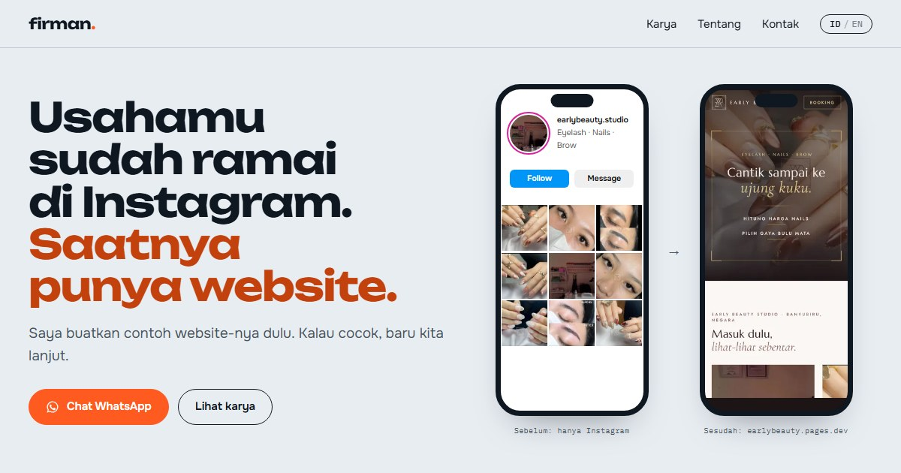

<p align="center">
  
</p>

<h1 align="center">Firman Fadilah</h1>

<p align="center"><b>Website yang tetap bekerja saat kamu sibuk melayani.</b></p>

<p align="center">
  <a href="https://firmanfadilah.pages.dev">firmanfadilah.pages.dev</a>
</p>

<p align="center">
  
</p>

Portofolio pribadi Firman Fadilah, mahasiswa Informatika Universitas Udayana di Bali. Website ini punya dua pembaca: pemilik usaha yang belum punya website, dan perekrut yang ingin melihat karya serta pengalaman kerja. Pemilik usaha langsung diarahkan ke WhatsApp, sedangkan perekrut mendapat bukti di layar pertama: juara lomba poster, sertifikasi BNSP, nilai PPIDK, dan produk yang sudah online.

Tidak ada backend, login, atau halaman admin. Semua isi ada di satu file.

## Fitur

| Fitur | Keterangan |
|---|---|
| Hero | Janji dalam satu kalimat, tombol WhatsApp, dan tiga karya pilihan yang ditumpuk seperti cetakan dan merenggang saat di-scroll |
| Kalimat besar | Cara pandang Firman, kata demi kata menyala saat dibaca |
| Instagram ke website | Contoh nyata Early Beauty: foto dari profil Instagram berpindah ke HP kedua dan berubah menjadi website aslinya |
| Baris bukti | 3 juara lomba poster, nilai PPIDK 95, sertifikasi BNSP, dan Kioku terdaftar HKI. Angkanya menghitung naik saat terlihat |
| Karya | 3 karya pilihan di beranda, semua karya di `/karya` dengan filter *Website klien*, *Sistem & produk*, dan *Desain* |
| Panel detail | Ketuk kartu untuk membaca cerita, peran, teknologi, link live, kode, dan bukti penghargaan |
| Pengalaman | OJT PT Gapura Angkasa, PPIDK PT Citra Konsultama Indonesia, sertifikasi BNSP, dan penghargaan |
| Cara kerja dan tanya jawab | Langkah membuat website untuk UMKM, tanpa daftar harga |
| Dua bahasa | Indonesia di `/` dan `/karya/`, Inggris di `/en/` dan `/en/work/`. Tombol ID / EN membuka halaman pasangannya |

## Menambah karya

1. Simpan gambarnya di `src/assets/shots/` (tangkapan layar) atau `src/assets/posters/` (desain).
2. Tambahkan satu entri di `PROJECTS` dalam [`src/data/site.js`](src/data/site.js). Setiap teks ditulis dalam dua bahasa: `{ id: "...", en: "..." }`.
3. Agar tampil di beranda, tambahkan `slug`-nya ke `FEATURED`.

Hal yang menunggu file dari Firman juga diatur di file yang sama: `ME.photo` (foto di bagian Tentang), `ME.cv` (tombol unduh CV), dan `cert` di `EXPERIENCE` (sertifikat magang Gapura Angkasa). Selama nilainya `null`, bagian itu menampilkan slot kosong atau tidak tampil.

## Teknologi

| Bagian | Teknologi |
|---|---|
| Framework | [Astro](https://astro.build) 7, halaman statis tanpa React atau Tailwind |
| Animasi | CSS dan JavaScript ringan, [Lenis](https://lenis.darkroom.engineering) untuk smooth scroll |
| Gambar dan font | `astro:assets` (WebP otomatis), font disimpan sendiri lewat Astro Fonts API |
| Tes | `node:test` untuk helper bahasa, link WhatsApp, filter karya, dan kelengkapan data |
| Hosting | Cloudflare Pages |

## Struktur

```
src/
├── components/   Satu file per bagian halaman, berisi markup, gaya, dan script-nya sendiri
├── data/         Semua isi dan teks dua bahasa (site.js), serta daftar gambar
├── lib/          Helper bahasa dan filter karya, beserta tesnya
├── layouts/      Kerangka halaman, meta SEO, hreflang, dan pratinjau link
├── views/        Susunan beranda dan halaman karya
├── pages/        Empat route: /, /karya/, /en/, /en/work/
├── scripts/      Animasi muncul saat scroll, hitung angka, dan smooth scroll
└── styles/       Warna, font, dan gaya bersama
```

## Menjalankan

```bash
npm install
npm run dev      # http://localhost:4321
npm test         # helper dan kelengkapan data
npm run build    # hasil statis di folder dist/
```

Butuh Node.js 22.22 atau lebih baru (lihat `.node-version`).

## Catatan desain

- Latar abu kebiruan terang dengan tinta hampir hitam, satu warna oranye untuk tombol WhatsApp dan penanda penting, serta satu bagian gelap untuk karya pilihan dan kontak.
- Font: Unbounded (judul), Onest (teks), dan IBM Plex Mono (label dan angka).
- Semua animasi memakai satu jenis easing, hanya berjalan sekali, dan mati untuk pengguna yang mengaktifkan "kurangi animasi". Tanpa JavaScript, semua isi tetap tampil.
- Sertifikat ditampilkan sebagai ringkasan tanpa scan dan tanpa nomor sertifikat.

## Hak cipta dan atribusi

- Foto dan tangkapan layar Early Beauty Studio dipakai atas izin pemilik.
- Font [Unbounded](https://fonts.google.com/specimen/Unbounded), [Onest](https://fonts.google.com/specimen/Onest), dan [IBM Plex Mono](https://fonts.google.com/specimen/IBM+Plex+Mono): SIL Open Font License 1.1.
- [Lenis](https://github.com/darkroomengineering/lenis): MIT License.
